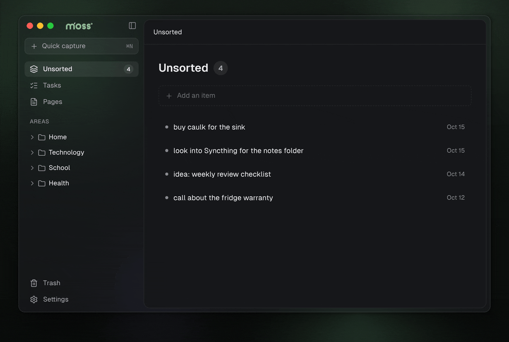
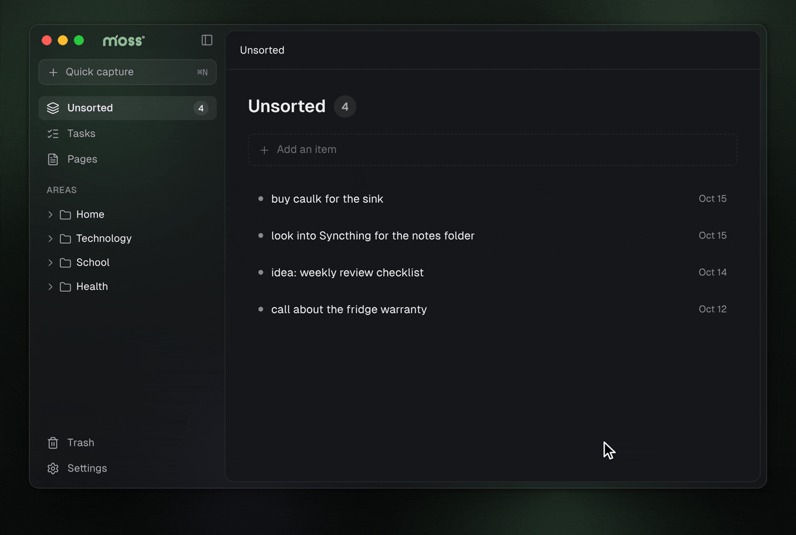
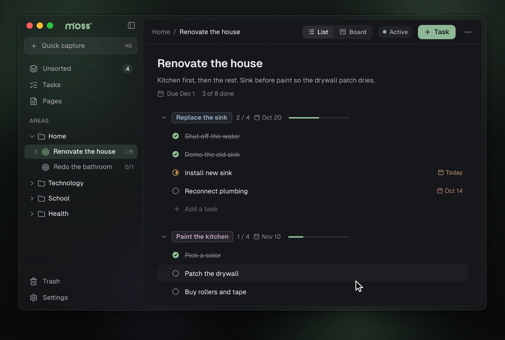
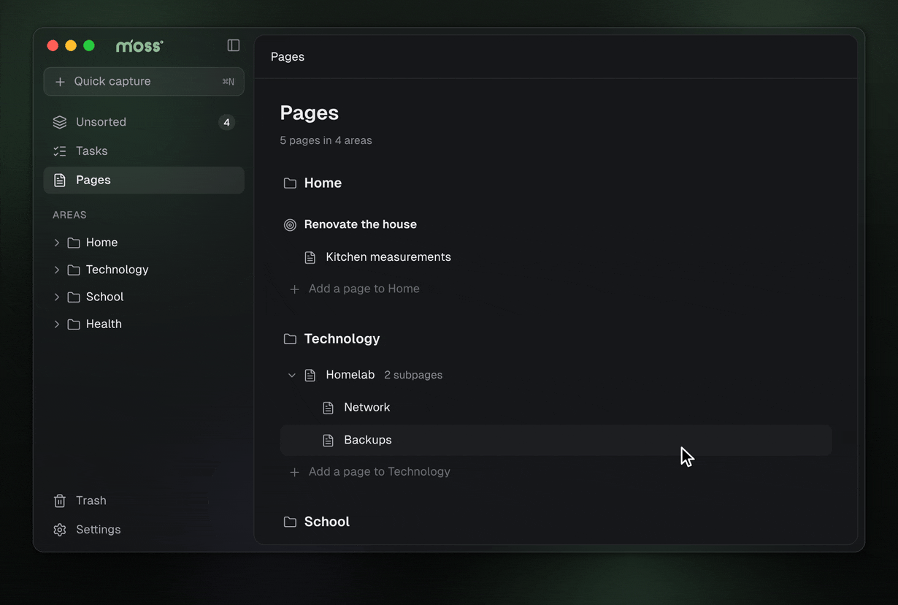

<h1>
  <picture>
    <source media="(prefers-color-scheme: dark)" srcset="brand/wordmark-dark.svg">
    
  </picture>
</h1>

A local-first desktop app for tasks and pages. Capture anything into **Unsorted**, then sort it into a strict hierarchy: **Area → Project → Milestone → Task**, with **Pages** kept right next to the area or project they're about.

Everything is stored as plain markdown files in a folder you choose, laid out so it reads well in Finder:

```
data/
├── unsorted.md
└── areas/
    └── Home/
        └── Renovate the house/
            ├── Pages/
            │   └── Kitchen measurements.md
            └── Replace the sink/
                └── Install new sink.md
```

```markdown
---
id: TSKINSTL01
status: doing
order: t
created: 2026-10-05
due: 2026-10-17
---
Same footprint as the old one, so no counter cut.
```

No account, no database, no sync service. Point any folder sync at it if you want it on more than one machine.

Built with [Tauri](https://tauri.app) (Rust) and React.

## A quick look

**Quick capture.** ⌘N from anywhere, type, Enter. It goes to Unsorted.



**Unsorted.** Open an item, choose what it becomes and where it goes. The next one opens so you can keep going.



**Tasks.** Each area, project and milestone has a List and a Board. Drag cards between statuses.



**Pages.** Rich text on screen, plain markdown on disk. Type "/" for headings, lists, checklists, tables and subpages.



## Installing

Download the latest build from [Releases](https://github.com/XanderOnGithub/task-manager/releases/latest).

- **macOS:** open the `.dmg` (`aarch64` for Apple silicon, `x64` for Intel) and drag Moss to Applications. Moss isn't signed with an Apple Developer ID yet, so the first time macOS says it can't be opened: go to System Settings → Privacy & Security and click **Open Anyway**.
- **Windows:** run the `-setup.exe` or the `.msi` (stick with the same one when you reinstall). If SmartScreen warns, click **More info → Run anyway**. The `_portable.exe` runs without installing.
- **Linux:** the `.AppImage`, `.deb` or `.rpm`.

From 0.1.2 on, Moss updates itself: when a new version is out, **Update to …** appears in the sidebar (or use **Check for updates** in Settings). The portable `.exe`, `.deb` and `.rpm` don't update themselves; download those again.

## Development

Requirements: Rust (stable), Node 22, pnpm 10, and on macOS the Xcode command line tools.

```sh
pnpm install
pnpm tauri dev
```

The first dev run opens a copy of `sample-data/`, so there's something to look at.

```sh
cargo test -p task-core                                  # tests
cargo run --release -p task-core --example bench         # loading benchmark
```

Loading 10,000 tasks (plus 1,000 pages with 20 KB bodies) takes about 70 ms, because only the frontmatter of each file is read.

On macOS, Settings includes an opt-in native refresh-rate switch for ProMotion
displays. It uses `tauri-plugin-macos-fps` to unlock rendering above 60fps; the
switch remains off by default to avoid unnecessary battery use.

## Branches and releases

Moss is in **alpha**. Nothing is pushed to `main` directly:

```
feature/…  fix/…  refactor/…   →  pull request into the current release branch
release/alpha-0.1              →  pull request into main when it's ready to ship
main                           →  every merge with a new version is released
```

When a new version lands on `main`, GitHub Actions (`.github/workflows/release.yml`)
builds installers for macOS (Apple silicon and Intel), Windows and Linux and
publishes them as a GitHub Release named after the version ("Moss alpha 0.1.0"),
with notes made from the merged pull requests. Pushes to `main` that don't
change the version build nothing.

To start the next version, branch `release/alpha-0.2` from `main` and bump
`version` in `src-tauri/tauri.conf.json`, `package.json` and both `Cargo.toml`
files there. The stage (`alpha`) is `"stage"` in `package.json`.

The builds aren't signed with a Developer ID or Windows certificate yet. The
Mac app is signed ad hoc (`"signingIdentity": "-"`), so macOS offers "Open
Anyway" rather than calling it damaged; Windows SmartScreen warns. Update files
are signed separately with the updater key (see CLAUDE.md).
